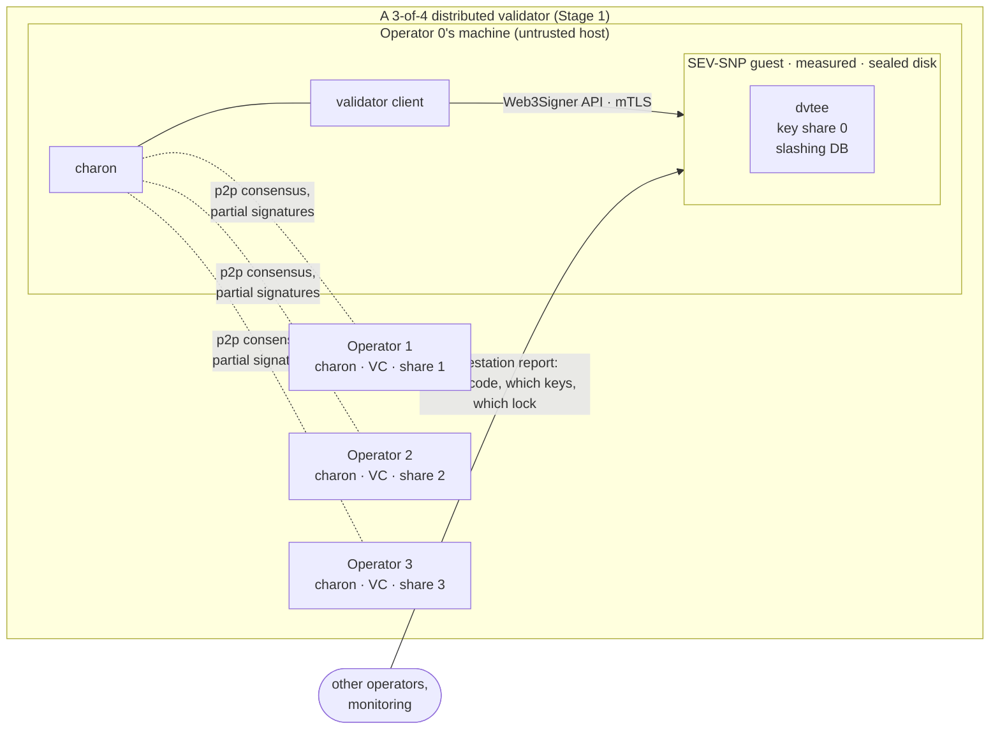

<h1 align="center">DVTEE<br/>Distributed validators, with every share sealed in a TEE</h1>

<p align="center">
<a href="https://github.com/ObolNetwork/dvtee/actions/workflows/signer.yml"></a>
<a href="LICENSE"></a>


</p>

A [distributed validator](https://docs.obol.org/docs/int/key-concepts) already removes the single key: no one
operator can sign alone, and one failure won't slash you. That's
[Validator Beat's Stage 1](https://validatorbeat.com/methodology/).

**DVTEE is the next layer.** It moves each operator's key share into a confidential VM that the operator's own
machine can't look inside. The host can't read the share, can't copy it, and can't talk the signer into a
slashable or off-policy signature. The other operators can check which code is holding the share before they
trust it.

The piece that does this is **`dvtee`**. It's a small Rust BLS signer, built to run in an AMD SEV-SNP
guest, behind the standard [Web3Signer](https://docs.web3signer.consensys.io/) API. Charon and your validator
client don't change: you point the VC at a different URL.



> [!WARNING]
> **Experimental. Not for mainnet keys.**
> * The signer runs in charon clusters on devnets with four validator clients, through Electra, Fulu and
>   Gloas.
> * The guest image builds reproducibly but **has not booted on SEV-SNP hardware yet**. That's the next
>   milestone, together with a Hoodi run.
> * It is unaudited.
>
> [ROADMAP.md](ROADMAP.md) has the full status and the [known gaps](ROADMAP.md#known-gaps).

## What the TEE adds to a distributed validator

| A Stage 1 DV on its own | With DVTEE |
|---|---|
| A compromised operator machine holds a readable key share. | The share lives only inside the guest, on a disk sealed to the chip and the measured image. The host sees ciphertext. |
| Slashing protection is a file the host can edit, delete or roll back. | Watermarks are kept inside the guest and written before every signature. A **start floor** from a Roughtime quorum refuses to sign for the past after a restart, so a rolled-back disk can't double-sign. |
| A compromised VC or charon can ask the signer for any signature. | Every signing root is recomputed from the typed request. Fee recipients are pinned to the cluster lock. Exits need a separate role. Gloas builder bids are refused outright. |
| You trust that a peer runs what it says it runs. | `GET /api/v1/tee/attestation` returns a hardware report binding the code measurement, the TLS key, the BLS shares and the cluster lock hash. `dvtee verify-evidence` checks it offline, AMD chain included. |
| A lost box is a lost share. | Still a lost share, by design. Nothing exports keys. The cluster replaces or recovers the operator, as it would without a TEE ([docs/cluster-edits.md](docs/cluster-edits.md)). |

Each guest is one share, not the whole validator. A broken TEE, or a bug in one chip vendor's firmware, costs
one share. The cluster threshold still holds. That's why DVTEE leans on the DV for key generation, recovery and
image upgrades instead of trusting any single enclave.

## Highlights

* **Signs only what it can verify.** It never signs a client-supplied 32-byte root.
  * Signing roots are cross-checked byte for byte against go-eth2-client with herumi BLS (the stack charon
    uses), the consensus spec tests and Web3Signer's own examples.
* **Every Web3Signer eth2 request type through Gloas:**
  * attestations, blocks, aggregates and sync committee duties;
  * exits, registrations and deposits;
  * payload attestations, proposer preferences and self-built payload envelopes.
* **EIP-3076 slashing protection,** checked against the interchange test suite, with import and export.
* **Pinned to the cluster lock.** The signer pins the charon lock on first start and checks its hashes and
  aggregate signature. After that it refuses any other lock, and any fee recipient the lock didn't agree.
* **Client roles.** mTLS client certificates and tokens carry `duties`, `exit` or `deposit` roles, so the
  validator client can't sign an exit.
* **A measured, minimal guest.**
  * Debian from a pinned snapshot, built with mkosi.
  * A UKI with `kernel-hashes=on`.
  * A dm-verity root, and a LUKS2 data disk with AEAD integrity sealed to the SNP measurement.
  * No shell, getty or sshd.
  * Builds from two separate checkouts are byte-identical, so anyone can recompute the expected measurement.
* **Small.** About 7,500 lines of Rust outside tests. It uses blst, ring and rustls, and no consensus-types
  library.

**Tested against** Lighthouse, Teku, Lodestar and Prysm, each signing through its own signer as one operator of
a 3-of-4 charon cluster ([`e2e/devnet/`](e2e/devnet/README.md)).
* Charon verified every partial signature, and every duty reached the chain, Gloas payloads included.
* The cluster kept working with one node down.
* Slashing protection held across restarts.

## Quickstart (development, no TEE)

```sh
cd signer
cargo build --release --features insecure-dev

./target/release/dvtee serve \
  --platform insecure-dev \
  --network hoodi \
  --keystores-dir /path/to/.charon/validator_keys \
  --cluster-lock /path/to/.charon/cluster-lock.json \
  --data-dir ./data \
  --listen 127.0.0.1:9000
```

* **Point the validator client at `https://127.0.0.1:9000`,** and trust `./data/tls/cert.pem`.
  [`signer/README.md`](signer/README.md#validator-clients) has the flags for each client.
* **`insecure-dev` has no security.** It's for development, and it refuses mainnet. In a real deployment the
  signer runs as `--platform tee` inside the guest image.
* **Check a running signer:**

```sh
NONCE=$(openssl rand -hex 32)
curl --cacert data/tls/cert.pem "https://127.0.0.1:9000/api/v1/tee/attestation?nonce=$NONCE" > evidence.json
./target/release/dvtee verify-evidence --evidence evidence.json --nonce $NONCE \
  --expected-cluster-lock-hash <hex> --allow-insecure-dev
```

In a guest, drop `--allow-insecure-dev` and add `--expected-measurement <hex> --fetch-vcek`.

See [`signer/README.md`](signer/README.md) for every option, the API, mTLS and tokens, and testing.

## On SEV-SNP hardware

* [`image/`](image/README.md) builds the guest image, and
  [`scripts/expected-measurement.sh`](scripts/expected-measurement.sh) computes its launch measurement from the
  build output.
* [docs/hardware-runbook.md](docs/hardware-runbook.md) is the step-by-step first run on a bare-metal AMD EPYC
  host. It covers:
  * the OVMF build and the image build;
  * first boot and attestation;
  * seal and unseal across reboots;
  * negative tests;
  * a charon devnet with the signer in the guest.

## Repository layout

| Path | What it is |
|------|------------|
| [`signer/`](signer/) | `dvtee`, the signing service |
| [`image/`](image/), [`ovmf/`](ovmf/), [`scripts/`](scripts/) | The reproducible guest image, firmware, measurement and launch tooling |
| [`e2e/`](e2e/) | Devnet and simnet harnesses with charon and real validator clients |
| [`docs/`](docs/) | [Threat model](docs/threat-model.md), [cluster edits](docs/cluster-edits.md), [load test](docs/load-test.md), [hardware runbook](docs/hardware-runbook.md) |
| [ARCHITECTURE.md](ARCHITECTURE.md) | Measured boot and disk sealing |
| [ROADMAP.md](ROADMAP.md) | Status, design choices, known gaps |
| [`poc/`](poc/) | The 2024 proof of concept: charon's DKG and stock Web3Signer inside an SNP guest |
| [`vm-scripts/`](vm-scripts/), [`linux-mainline-sev-src/`](linux-mainline-sev-src/) | The 2024 prototype image, superseded by `image/` and kept for reference. **Not safe for keys** |

## Where it's going

* **Hardware and Hoodi.** A first boot on SEV-SNP hardware, then one operator of a live Hoodi DV signing
  through the guest.
* **Keys born in the TEE.** Charon's DKG delivers each share straight into the guest over attested TLS. Later,
  the DKG runs inside the guest.
* **Cluster edits with guests.** Recover, reshare and replace-operator, ordered by a threshold of operators
  ([design](docs/cluster-edits.md)).
* **More TEEs.** Evidence comes from Linux configfs-tsm, so Intel TDX and Arm CCA use the same code path.
  Mixing vendors within one cluster is the long-term goal: one share per chip family.

## Contributing

Useful git hooks live in `.githooks`. Enable them with:

```sh
git config --local core.hooksPath .githooks
```

Security issues: see [SECURITY.md](SECURITY.md).

## License

[Business Source License 1.1](LICENSE), changing to GPL-3.0 four years after each
version's release. Production use outside the Additional Use Grant needs a
commercial license from Obol.

Third-party files keep their own licences: the kernel packaging and patches in
`linux-mainline-sev-src/` and `initramfs-init` (GPL-2.0, from Alpine aports and
mkinitfs), and the edk2 firmware built by `ovmf/` (BSD-2-Clause-Patent and its
submodules' licences).
